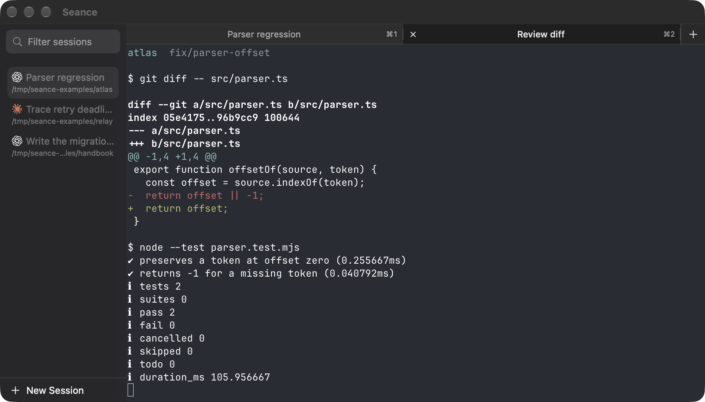
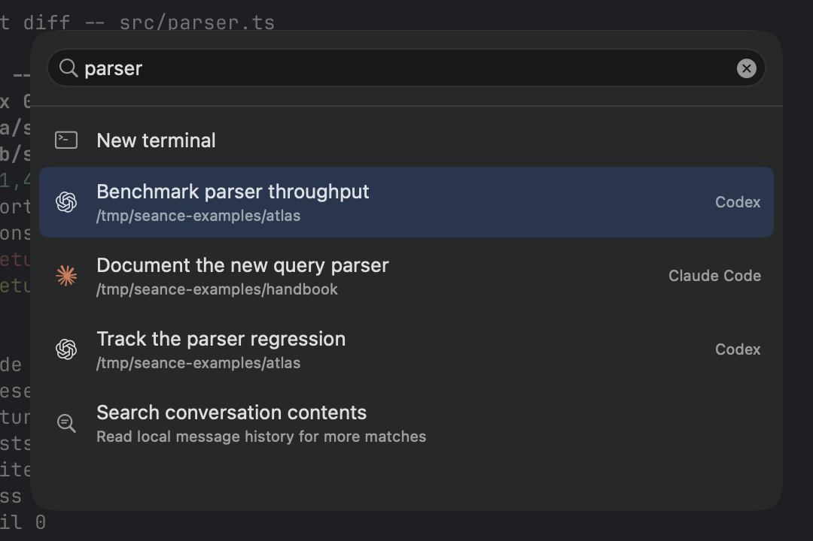

# Seance

A macOS terminal for developers who work with Claude Code and Codex. Find a local conversation, resume it in the directory where it started, and keep a shell beside it for reviewing the diff or running tests.

**[Download Seance for Apple Silicon](https://github.com/elmcrest/Seance/releases/latest)** · [Build from source](docs/guide.md#build-and-run)

On macOS 14 or later, unzip the release and drag Seance into Applications. Open it and press **⌘N** to find your first session.

## Find the conversation you remember

Press **⌘N** to search Claude Code and Codex sessions together by title, directory, provider, or session ID. Only remember something you typed? Choose **Search conversation contents** to search the messages on disk. Select a result and Seance runs the agent’s resume command in the project directory. When you exit the agent, you’re at a shell prompt in that same directory.

## Work alongside the agent

- **Open a shell where the work is.** Press **⌘T** for another terminal in the active terminal’s directory. **Ctrl+Tab** cycles through the window’s terminals, including those in other sidebar sessions.
- **Keep your Ghostty setup.** Seance embeds libghostty and reads your existing fonts, themes, and keybindings.
- **Let the agent label its work.** The optional MCP integration lets an agent name its own tab. You can also double-click a title to rename it yourself. [Connect Claude Code or Codex](docs/guide.md#connect-an-agent)

Seance has no telemetry, accounts, or upsells. Update checks run when you choose **Seance → Check for Updates…**. [Read the guide](docs/guide.md)

## Built with coding agents

Seance is proudly built with coding agents. This is an agent-friendly project, and pull requests are welcome whether you write the code yourself or work with an agent. For each PR, I choose the model I consider most capable for the change and have it review the code.

[Development guide](docs/guide.md#build-and-run) · [MIT license](LICENSE)
